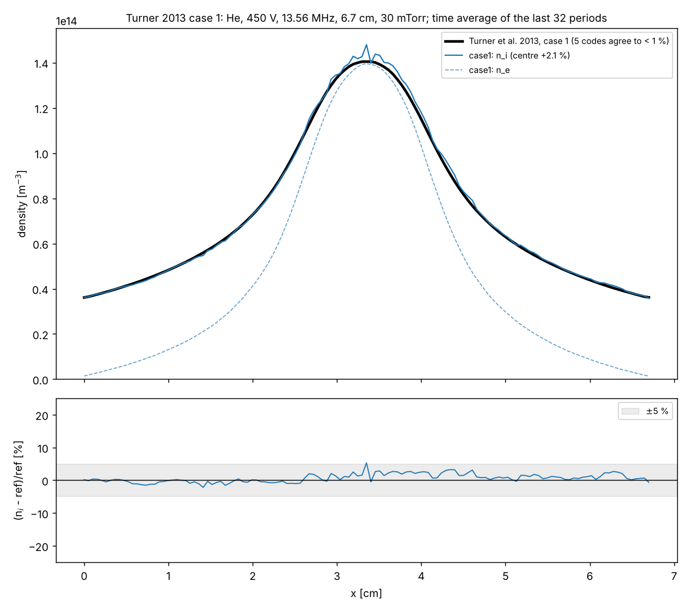
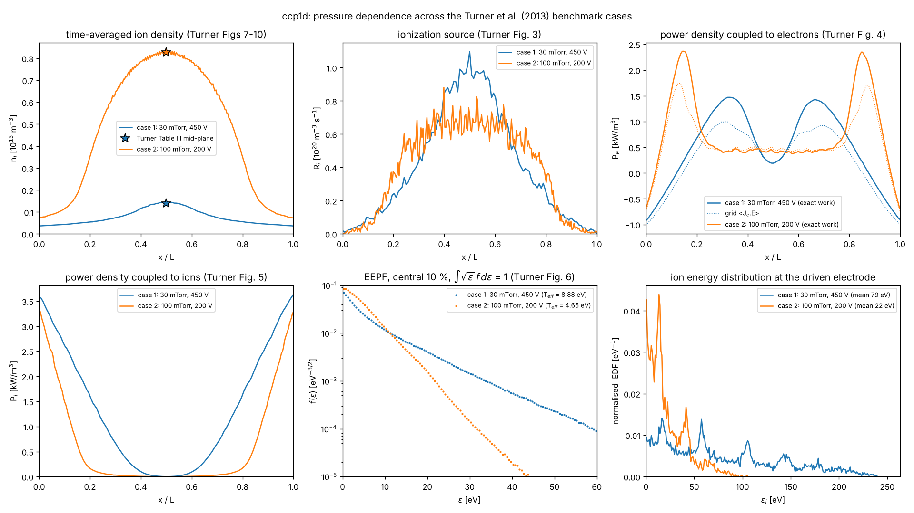

# ccp1d — 1D bounded electrostatic PIC/MCC for an RF capacitive discharge

Fortran 90 + MPI. Target: the helium benchmark of Turner et al., Phys. Plasmas 20, 013507 (2013), Case 1.
Specification: [`../HANDOVER.md`](../HANDOVER.md); plan and test matrix: [`PLAN.md`](PLAN.md); progress: [`PROGRESS.md`](PROGRESS.md).

**Status (2026-11-04): all milestones M0-M7 done.** The time-averaged ion density of the full-size
Case 1 run (`results/case1/`) agrees with the Turner et al. reference to +2.1 % at the centre and
1.5 % rms over the gap (4 ranks, 170 s); the electron and ion power and the ion current of Turner's Table III are reproduced to 0.7 % (`tools/compare_table3.py`). Case 2 (100 mTorr, 200 V, `results/case2/`, 4 ranks, 68 min) reproduces Turner's Table III to -0.4 % in the
mid-plane density and within 1.2 % in electron temperature, electron and ion power and ion current;
`results/case_comparison.png` (`tools/compare_cases.py`) shows both cases in the units of Turner's Figures 3-10.
`tools/theory_check.py` compares each run with the classical formulas (`doc/theory.md`): the sheath-side theory (RF Child law, ion energies, sheath capacitance) agrees to 3-7 % in both cases, the local electron theory (Boltzmann relation, ohmic heating, global-model T_e, h_l) only at 100 mTorr. Halving dt, halving dx or doubling the particles per cell
changes the profile by less than twice the seed-to-seed noise (`results/conv/`, `tools/convergence.py`).
The diagnostics (IEDF/EEPF, x-t maps, power budget, energy balance) pass 23 self-consistency checks
(`tools/check_diag.py`); the total current J_e + J_i + eps0 dE/dt is uniform in x to 1.7 %.
Dual frequency (M7, `results/dual/`): adding 1.356 MHz at 50-150 V raises the maximum ion energy from
240 to 298 eV (always about half of V0 + V_lf) while the centre density falls by 9-45 %; at 200 V the
sheaths fill the 6.7 cm gap and the discharge extinguishes. The electron swarm test (M3, `make check-swarm`,
`results/swarm/`) compares the same push and collision routines in a uniform field with an independent
two-term Boltzmann solver (`tools/boltzmann2term.py`): mean energy and drift velocity agree to 0.1-1 % at
20-200 Td.





## Build, test, run

```sh
./setup.sh          # once per fresh container (repository root): gfortran, Open MPI, numpy, matplotlib
cd ccp1d
make                # -O3 executable ./ccp1d (objects in obj/)
make debug          # checked executable ./ccp1d_dbg (-fcheck=all -ffpe-trap ...)
make check          # unit tests T1-T3, T8, T10 with the debug flags (~1 min)
make check-rng      # statistical tests of the random generator in the loading pattern (~1 min)
make check-swarm    # T12 electron swarm vs the two-term Boltzmann solver (~8 min, optimised build)
mkdir -p runs/case1_test && cp inputs/case1_test.in runs/case1_test/ccp1d.in
cd runs/case1_test && mpirun --allow-run-as-root -np 2 ../../ccp1d [input_file]
```

The run directory holds `ccp1d.in` (namelist `&ccp1d`, see `inputs/*.in` and `input.f90` for every key)
and all output. Restart: `restart = .true.` continues from `restart_*.bin`; `periods_this_run = N`
stops after N periods, `max_wall_minutes = M` stops cleanly after M minutes (both write restart files).

## Source files

| file | role |
| --- | --- |
| `input.f90` | namelist, checks, derived quantities (dx, dt, weight, maxnp), drive voltage `v_drive(t)` |
| `global.f90` | constants, species, grid and particle arrays, counters, `add/remove_particle`, `abort_run` |
| `random.f90` | ran2 (as em2's dran2) with saveable state, Box-Muller |
| `poisson.f90` | tridiagonal Poisson solve with Dirichlet electrodes, E on nodes and faces |
| `deposit.f90` | CIC deposit of rho (all ranks) and of the species moments |
| `push.f90` | leapfrog push, electrode absorption, exact work and Shockley-Ramo current sums |
| `diag.f90` | history, window averages, histograms, x-t maps, energy balance, info.txt, restart files |
| `init.f90` | random uniform loading with Maxwellian velocities, field at t = 0, leapfrog half step |
| `main.f90` | MPI, time loop |
| `xsec.f90` | cross-section tables on uniform energy grids (knots aligned with the tables), thresholds, nu_max |
| `mcc.f90` | null-collision Monte Carlo: electron elastic/excitation/ionization, ion isotropic/backward (charge exchange), energy ledgers |
| `tests/` | T1 poisson, T2 deposit, T3 random, T4 xsec, T5-T7 mcc (rates, kinematics, relaxation), T8 restart (bit-identical, with collisions), T10 Langmuir; `make check-rng` generator statistics; `swarm/` T12 electron swarm |
| `tools/` | `compare_turner.py` (Case 1 density profile vs the reference), `compare_table3.py` (T18, any case vs Turner Table III), `compare_cases.py` (several runs side by side in the units of Turner's Figs 3-10), `theory_check.py` (classical formulas vs the run: Child law, Bohm, h_l, Boltzmann relation, ohmic and stochastic heating, eps_c, global model; see `doc/theory.md`), `convergence.py` (T15), `dual_frequency.py` (T17), `boltzmann2term.py` + `compare_swarm.py` (T12), `check_run.py` (13 sanity checks), `check_diag.py` (T16, 23 self-consistency checks), `plot_xt.py`, `plot_power.py`, `plot_history.py`, `plot_profiles.py`, `plot_dist.py`, `check_sheath.py`, `plot_initial.py`, `draw_flow.py`, `common.py` |
| `inputs/` | `case1.in` (full size), `case1_test.in` (nx = 32, minutes), `dual_*.in` (dual frequency), `sheath.in`, `init_case1.in` |
| `doc/` | `program_flow.md` + `fig/program_flow.png` (module-by-module explanation with completion status), `initial_conditions.md` (what is loaded at t = 0 and why, with figures) |
| `results/` | small result files of the reference runs (`case1/`, `conv/` convergence set, `dual/` dual-frequency series, `swarm/` electron swarm, `case1_test/`, `sheath/`, `init_case1/`) |

## Output files (all ASCII, `#` headers with column names and units)

`info.txt` (parameters, derived numbers, results and the energy balance), `history.dat` (one line per period),
`profiles.dat` (time averages over the last `n_avg` periods), `iedf_left/right.dat`, `eedf_left/right.dat`,
`eepf.dat`, `xt_*.dat` (phase-resolved maps), `restart_*.bin`. Column lists are in the file headers and in
`tools/common.py`.
