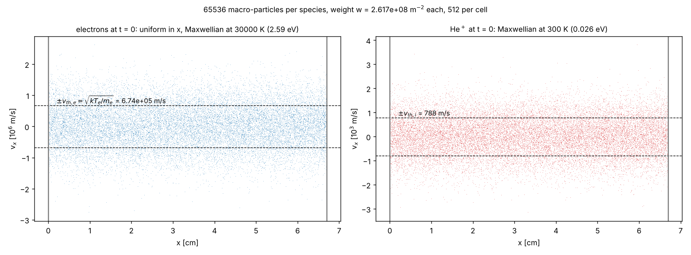
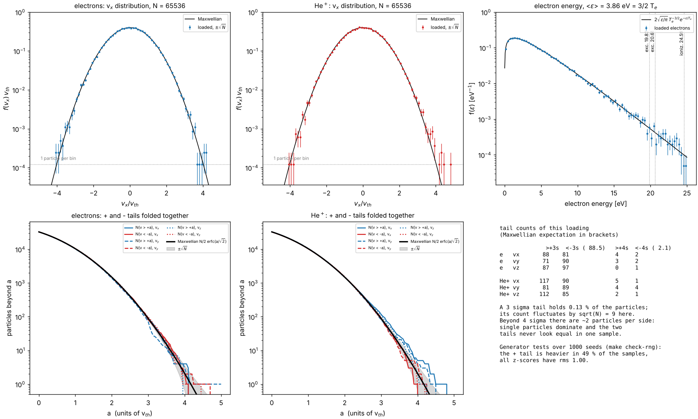
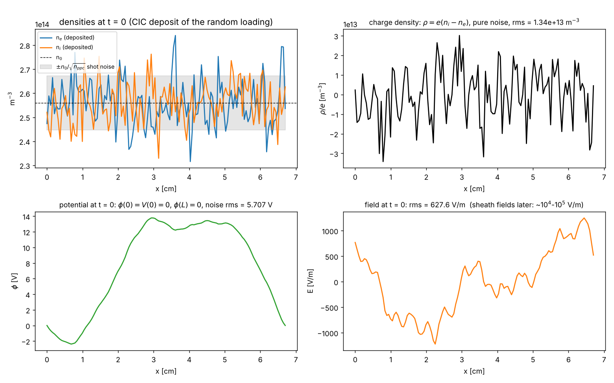
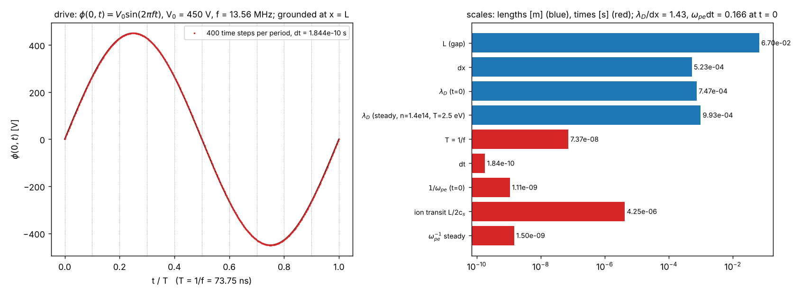
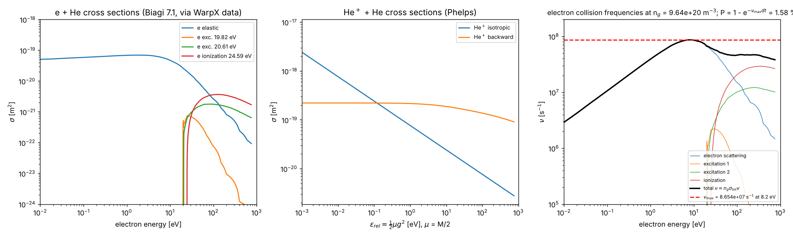
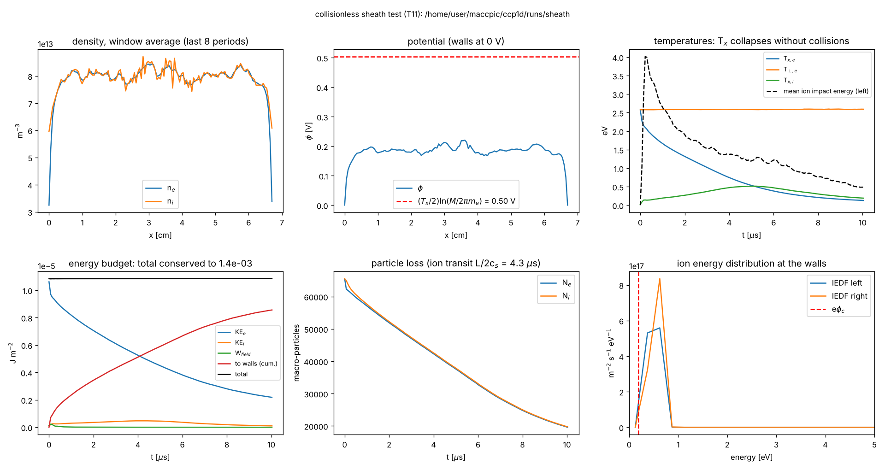

# ccp1d 初始条件讲解：Turner Case 1 在 t = 0 装了什么、为什么

本文配 `doc/fig/init_*.png` 五张图，解释 `inputs/init_case1.in` 这次运行在 t = 0 时放进模拟盒子里的东西，以及每个选择背后的数值和物理理由。图由 `tools/plot_initial.py` 从代码自己输出的 `init_particles_rank*.dat`、`init_grid.dat`、`info.txt` 和截面表 `data/he/` 画出，不是示意图。最后一节是无碰撞鞘层算例（M1）的结果，它是这套初始条件 + 推进器的第一个物理检验。

## 0. 一句话

一个 6.7 cm 的平行板间隙，装入**均匀、准中性、Maxwell 分布**的氦等离子体（n0 = 2.56×10¹⁴ m⁻³，T_e = 30000 K = 2.59 eV，T_i = 300 K）；x = 0 的电极从 t = 0 起加 450 V、13.56 MHz 的正弦电压，x = L 的电极接地；中性氦气（30 mTorr，n_g = 9.64×10²⁰ m⁻³，300 K）是固定背景，不作为粒子。然后让放电自己演化 1280 个射频周期（94 µs），取最后 32 个周期平均。初值只是起点，稳态与它无关——这正是要跑那么久的原因。

| 量 | 值 | 来源 |
| --- | --- | --- |
| 宏粒子数（每种） | 65536 = 128 格 × 512 | Turner 表 I |
| 权重 w | 2.617×10⁸ m⁻² | n0·L/N |
| dx | 0.5234 mm | L/128 |
| dt | 1.844×10⁻¹⁰ s | 1/(400 f) |
| λ_D(t=0) | 0.747 mm，λ_D/dx = 1.43 | sqrt(ε0 kT_e/(n0 e²)) |
| ω_pe(t=0) | 9.03×10⁸ rad/s，ω_pe·dt = 0.166 | sqrt(n0 e²/(ε0 m_e)) |
| v_th,e·dt/dx | 0.24 | 热电子一步走 1/4 格 |
| 离子渡越 L/2/c_s | 4.3 µs = 58 周期 | c_s = sqrt(kT_e/M) = 7880 m/s |
| ν_max（电子） | 8.65×10⁷ s⁻¹（8.2 eV 处），P = 1 − e^(−ν_max dt) = 1.58 % | 截面表 |

## 1. 粒子：相空间与速度分布（图 1、图 2）



**图 1** 是 t = 0 的 x–v_x 相空间（每种只画 2 万个点）。两条虚线是 ±v_th = ±sqrt(kT/m)：电子 6.74×10⁵ m/s，离子 788 m/s——相差 855 倍，因为 sqrt(M/m_e)·sqrt(T_e/T_i) = 85 × 10。位置在 [0, L) 上**均匀随机**（x = L·U，U 是 (0,1) 均匀随机数，ran2 生成器，每个 MPI 进程不同种子），所以相空间是没有结构的"雪花"。

**权重**：一个宏粒子代表 w = n0·L/N = 2.6×10⁸ 个真实粒子**每平方米电极面积**。一维模型里密度 n [m⁻³] 乘长度才是守恒量，所以权重的量纲是 m⁻²。所有宏粒子权重相同，电离产生的新粒子也用同一个 w（Turner 基准的规定）。

**1d3v**：位置一维，速度三个分量。三个分量各自从 Maxwell 分布抽（Box–Muller 变换，σ_v = sqrt(kT/m)）。为什么速度要三维：碰撞是三维事件（各向同性散射把能量分到三个分量），电子的能量（决定能不能电离）也是三维的。



**图 2 上排**检查装载质量：左、中是 v_x 的直方图（对数坐标，误差棒是 Poisson 的 ±sqrt(N)）与高斯曲线，重合到 ±3.5 v_th 以外；再往外每个格里只有 0–2 个粒子（灰色虚线是"一格一个粒子"的高度），点只能落在 1、2、3 个粒子对应的离散高度上。右是电子**能量**分布 f(ε) ∝ sqrt(ε) e^(−ε/T_e)，平均 3.86 eV，期望 3/2 T_e = 3.88 eV。三条竖线是激发（19.82、20.61 eV）和电离（24.59 eV）阈值：初始电子里超过阈值的只有 ~10⁻⁴，所以**放电一开始几乎没有电离**，必须先由射频鞘层把电子加热，才有电离来平衡壁面损失。

**尾巴看起来不对称怎么办**（图 2 下排）。肉眼看上排，+v 一侧的高速粒子似乎多一些。下排把 +a 以外和 −a 以外的粒子数折叠画在一起，再配上 Maxwell 期望值 N/2·erfc(a/√2) 和它的 ±sqrt(N) 带：3 v_th 以外每侧只有 88 ± 9 个粒子，4 v_th 以外只有 2 个，所以两侧**从来不会看起来一样**。这次装载的具体计数在右下表里：电子 v_x 在 +4 以外 4 个、−4 以外 2 个（期望 2.1）；离子 v_x 在 +3 以外 117 个、−3 以外 90 个（期望 88.5 ± 9.4，+ 侧高 3σ，是 12 个尾巴里最偏的一个）。判断它是不是系统偏差要靠大样本：`make check-rng` 跑三个测试——(1) 2×10⁷ 个粒子、同样的 7 次抽样节奏，六个分量 ±2…4.5σ 以外的计数全部在期望值的 ±2.6σ 内，且 ran2 与 gfortran 内置生成器表现一致；(2) 1000 个种子 × 两种粒子 × 三个分量共 6000 个 32768 粒子的样本，均值、偏度、四个尾部计数的 z 值的 rms 都是 1.00 ± 0.02，|z| > 3 的比例 0.2–0.35 %（期望 0.27 %），+3σ 尾比 −3σ 尾重的样本占 49 %；(3) 均匀数的 1–16 阶自相关和相邻粒子速度的相关都小于 5×10⁻⁴。结论：没有系统偏差，图上的不对称是 65536 个样本该有的涨落；换种子（`seed = 1, 2, 3`）重跑，哪一侧多是随机的。顺便说明装载的随机数顺序：每个粒子依次抽 x、v_x、v_y、v_z 共 7 个均匀数，代码里写成四条独立语句（Fortran 不保证同一参数表里函数的求值顺序）。

## 2. 网格量：从随机装载得到的 ρ、φ、E（图 3）



**沉积**（CIC，线性权重）：每个粒子的电荷按距离分给相邻两个节点，单位 C/m³。左上图里 n_e、n_i 都在 n0 附近，逐节点涨落 rms/n0 = 3.75 %，与散粒噪声估计 1/sqrt(512) = 4.4 % 一致（CIC 把一个粒子分到两个节点，略微平滑）。两端节点只有半个格的体积，输出时乘 2。

**ρ = e(n_i − n_e)**（右上）：纯噪声，rms 1.3×10¹³ m⁻³，是 n0 的 5 %。

**φ**（左下）：泊松方程 φ'' = −ρ/ε0，边界 φ(0) = V(0) = 0（正弦在 t = 0 过零），φ(L) = 0，Thomas 算法求解。虽然 ρ 是白噪声，φ 却有 ±14 V 的**长波**结构。原因：泊松方程是两次积分，把长波放大 1/k²。最长的模 k = π/L 的相对密度涨落约 1/sqrt(N_total) = 1/362，对应 δφ ≈ e n0 (L/π)² /ε0 × 1/362 ≈ 6 V，与图上的 rms 5.7 V 一致。这是**随机装载**的代价——"安静启动"（quiet start，把粒子放在相空间格点上）可以消掉它，但基准里的代码都用随机装载，这个涨落在几个等离子体振荡周期（~10 ns）内就被电子动力学抹平，对 94 µs 后的稳态没有影响。

**E = −dφ/dx**（右下）：中心差分，两端二阶单侧差分；rms 630 V/m。稳态鞘层里 E ~ 10⁴–10⁵ V/m，所以初始场可以忽略。代码里仍然用它做蛙跳的半步回推 v(−dt/2) = v(0) − (q/m)E(x)·dt/2——写法通用，以后换成非零初始场也不用改。

## 3. 驱动与尺度（图 4）



**左**：φ(0,t) = 450·sin(2π·13.56 MHz·t)，周期 T = 73.75 ns，每周期 400 步（红点），dt = 1.844×10⁻¹⁰ s。x–t 诊断把周期切成 100 个相位格（虚线每 10 格一条）。泊松方程每步用 t_{n+1} 时刻的电压作为左边界。

**右**是所有尺度放在一起（对数轴）：

- **空间**：λ_D/dx = 1.43（初始）；稳态中心 n ≈ 1.4×10¹⁴、T_e ≈ 2.5 eV 时约 1.9。网格分辨 Debye 长度，不会出现有限网格（网格加热）不稳定，经验判据 λ_D/dx ≳ 0.3。
- **时间**：ω_pe·dt = 0.166（初始）、0.12（稳态）。蛙跳对简谐振荡的稳定条件是 ω·dt < 2，精度要求 ≲ 0.2——一个等离子体振荡周期（6.96 ns）走 38 步。Langmuir 振荡测试（tests/langmuir）实测频率与蛙跳理论值 (2/dt)·asin(ω_pe dt/2) 相差 3×10⁻⁴。
- **电子一步走多远**：热电子 0.24 格；被鞘层加速到 450 eV 的电子 4.4 格。静电 PIC 的 CIC 沉积不要求"一步一格"，代码也不做这个假设，但吸收判据必须对任意距离成立（x < 0 或 x ≥ L 即吸收）。
- **离子渡越**：中心到壁 4.3 µs = 58 个周期 ≫ T，所以离子只感受时间平均的场（这是容性放电物理的核心：电子响应瞬时电压，离子响应平均电压）。1280 周期 = 94 µs ≈ 22 个渡越时间，足够达到稳态。
- **为什么 dt 不能更大**：对电子是 ω_pe·dt；对碰撞是 ν_max·dt ≪ 1（见下）。为什么 dx 不能更大：λ_D。两者一起决定了 Case 1 要走 512000 步。

## 4. 碰撞设置：截面与零碰撞法（图 5，M2 要实现）



**左**：电子–He 的四个过程（Biagi 7.1 截面表，经 WarpX 数据库）。弹性截面低能时近乎常数 ~6×10⁻²⁰ m²，10 eV 以上急剧下降（氦没有 Ramsauer 极小）；两个激发阈值 19.82、20.61 eV；电离阈值 24.59 eV，在 ~100 eV 达到峰值 3.7×10⁻²¹ m²。基准规定所有电子过程**各向同性散射**，电离后剩余能量两个电子**平分**。

**中**：He⁺–He 的两个过程（Phelps）。各向同性弹性 σ ∝ 1/sqrt(ε)（极化相互作用的 Langevin 行为，所以 σ·g 近似常数，低能碰撞频率有限）；背向散射 ~2×10⁻¹⁹ m²，缓慢下降——它就是共振电荷交换：离子换成中性原子的速度。能量变量是**质心系**相对能量 ε_rel = ½μg²，μ = M/2，不是实验室能量。

**右**：碰撞频率 ν = n_g σ v。电子总频率在 8.2 eV 处最大，ν_max = 8.65×10⁷ s⁻¹，于是 P = 1 − e^(−ν_max dt) = 1.58 %：**零碰撞法**每步只对 1.6 % 的电子抽一次碰撞判断，其余直接跳过，不用对每个粒子算截面。被选中的电子再按当前能量的各过程频率 ν_k 决定发生哪个过程，落在 Σν_k 之外的是"空碰撞"（什么都不发生）。离子的 ν_max = 2.79×10⁷ s⁻¹，P = 0.5 %。

气压 30 mTorr：电子平均自由程 1/(n_g σ) ≈ 2 cm，与间隙 6.7 cm 可比——低气压算例，电子加热以鞘层的随机加热为主，这也是 Case 1 需要动理学（PIC）而不是流体模型的原因。

## 5. 时间推进怎样起步

蛙跳格式里 x 在整数步、v 在半整数步。t = 0 装入的是 x(0) 和 v(0)，所以顺序是：沉积 ρ(0) → 解 φ(0)、E(0) → v 回推半步到 −dt/2 → 进入循环：(1) 推 v 到 +dt/2、x 到 dt，离开 [0, L) 的粒子记录能量后删除；(2) 碰撞（M2）；(3) 沉积 ρ(dt)；(4) 解 φ(dt)，边界 V(dt)；(5) 诊断累加。每步一次 `MPI_ALLREDUCE`（129 个数），粒子按进程均分，所有进程持有整个网格。

能量记账也从这里开始：推进时逐粒子累加 q·E_p·½(v⁻+v⁺)·dt，它等于动能增量 ½m(v⁺² − v⁻²)——这是**恒等式**，所以 `info.txt` 里的 `closure_relative` 必须是舍入误差量级（实测 10⁻¹⁶–10⁻¹¹）。真正的物理检验是把它和外电路功率 ⟨V·I⟩（Shockley–Ramo 电流 I = (w/L)Σqv_x）以及场能变化放在一起：P_VI − dW/dt − P_part 是格式的能量误差（`P_numerical`）。

## 6. 第一个物理检验：无碰撞鞘层（M1，`inputs/sheath.in`）



同样的初始等离子体，关掉气体和驱动（n_g = 0，V0 = 0，两壁接地），跑 10 µs。结果（`results/sheath/`，`tools/check_sheath.py` 全部通过）：

- **能量守恒**：动能 + 场能 + 已送到壁面的能量 = 常数，10 µs 内变化 5×10⁻⁴（左下图黑线），其间 80 % 的初始能量被壁面吸收。记账恒等式闭合到 10⁻⁸。
- **高斯定律**：ε0(E_{nx−1/2} − E_{1/2}) = Σρ_j dx 每步成立到 10⁻¹³。
- **左右对称**：两半的离子数之差 0.14 %；**通量平衡**：每个电极 Γ_e = Γ_i 到 1.6 %（鞘层把电子通量压到离子通量）。
- **一维无碰撞等离子体的特殊之处**（右上图）：电子的 T_x 从 2.57 eV 塌到 0.13 eV，而 T_⊥ 保持 2.58 eV 不变（没有任何机制交换 x 和 ⊥ 方向的能量；T_⊥ 不变本身就是对推进器的检验：v_y、v_z 不许被碰）。因此教科书的浮动电势 3.5 T_e 用 T_x 代入：φ_c = 0.19 V，比 (T_x/2)ln(M/2πm_e) = 0.50 V 低一些，因为 v_x 分布不是 Maxwell 而是被不断截断的分布。离子撞壁能量先升到 4 eV（鞘层刚形成时 T_x 还高）再随 T_x 下降。**这说明为什么 Case 1 需要碰撞和射频加热**：没有它们，电子在 x 方向会"冷死"；有了各向同性碰撞，T_x 和 T_⊥ 被不断混合，鞘层电势才能维持在几个 T_e。

## 7. 复现

```sh
cd ccp1d && make && make check                       # 编译 + 单元测试（约 1 分钟）
mkdir -p runs/init_case1 && cp inputs/init_case1.in runs/init_case1/ccp1d.in
cd runs/init_case1 && mpirun --allow-run-as-root -np 2 ../../ccp1d && python3 ../../tools/plot_initial.py .
cd ../.. && mkdir -p runs/sheath && cp inputs/sheath.in runs/sheath/ccp1d.in
cd runs/sheath && mpirun --allow-run-as-root -np 2 ../../ccp1d && python3 ../../tools/check_sheath.py . && python3 ../../tools/plot_history.py .
```

## 8. 可能被问到的问题

- **为什么每格 512 个粒子？** 噪声 ∝ 1/sqrt(N)。稳态中心密度降到 1.4×10¹⁴（初始的 55 %），每格约 280 个，瞬时密度噪声 6 %；对 32 个周期（12800 步）做时间平均后远小于 1 %，才能和基准比到 1 %。粒子太少还会有数值加热（粒子数少 → 场噪声大 → 电子被噪声场随机加热）。
- **初始条件影响结果吗？** 不影响稳态，只影响到达稳态的时间。Turner 让五个代码用同样的初值并跑满 1280 周期，是为了可比性；判断"到了稳态"看 `history.dat` 里粒子数和中心密度是否走平。
- **为什么离子只有 300 K？** 离子与气体碰撞频繁（背向散射 = 电荷交换），在体区里始终接近气体温度；它们的能量来自鞘层电场，不来自初值。
- **权重可以不同吗？** 可以（可变权重、粒子合并），但基准要求等权重；等权重下电离只增加粒子数，不改变统计性质，而且 Case 1 粒子数先降后平（稳态平均密度只有 0.29 n0），不需要合并。
- **泊松方程的边界为什么是电势而不是电场？** 电极是导体，由外电路固定电势（理想电压源）；电场由等离子体的电荷决定，是解出来的。两个 Dirichlet 条件 + 三对角求解，每步 O(nx)。
- **为什么是 1d3v 而不是 1d1v？** 碰撞和能量需要三维速度；磁场为零所以 v_y、v_z 在推进中不变，只在碰撞中改变。
