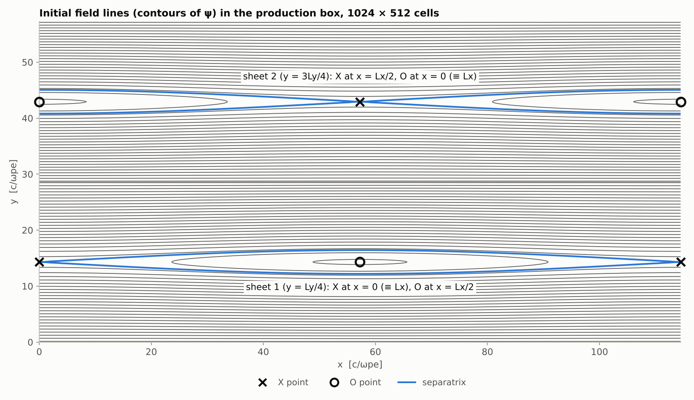
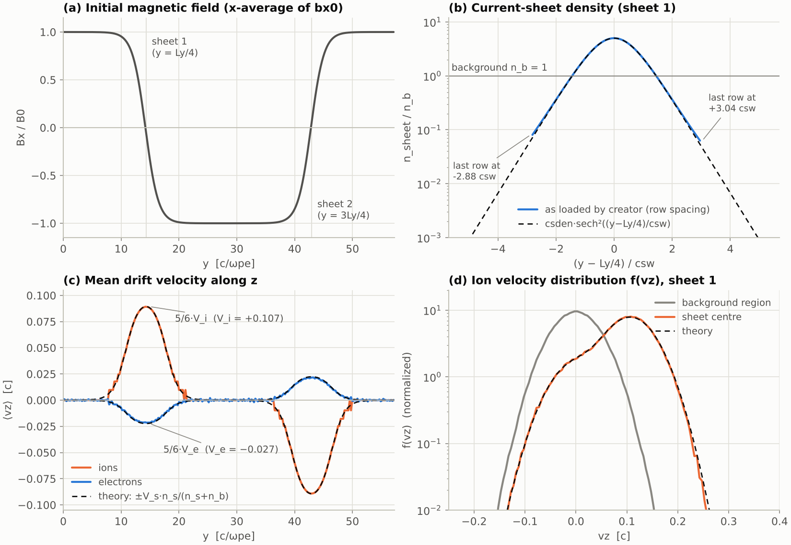

# The double Harris reconnection model in em2

[中文](#中文) | [English](#english) | [日本語](#日本語)

How the initial state of the reconnection run is built: magnetic field and perturbation (init.f90), density profile and particle positions (creator.f90), velocity distribution (creator.f90, smear.f90, setv.f90), and the drift velocity of the current sheets. All numbers are for the current input.f90. Usage of the code is in [README.md](README.md).

---

## 中文

### 1. 模型概要

二维 x–y 平面（∂/∂z = 0）。x 是反向磁场的方向（也是重联出流的方向），y 垂直于电流片（入流方向），电流沿 z。x、y 都是周期边界，所以放两个方向相反的 Harris 电流片：电流片 1 在 y = Ly/4，电流片 2 在 y = 3Ly/4。等离子体由均匀的背景（密度 n_b = 1）和两个电流片的粒子组成；初始时再加一个小的磁通扰动，在每个电流片上放一个 X 点。

主要参数（d_i 用电流片峰值密度定义：d_i = √(rmass/csden)·c/ωpe = 4.47 c/ωpe）：

| 量 | input.f90 中 | 当前值 |
|---|---|---|
| 远处磁场 B0 | abs(wce0) | 1.498（Ωce/ωpe = 1.50） |
| 背景密度 n_b | — | 1（n_b/n_峰 = 0.2） |
| 电流片峰值密度 | csden | 5 |
| 电流片半厚度 | csw | 2.236 c/ωpe = 0.5 d_i = 20 dx |
| 温度 | temp(1)，temp(2)·rmass | Te = 0.0449，Ti = 0.180（m_e c²），Ti/Te = 4 |
| 质量比 | rmass | 100 |
| 盒子 | nx·dx × ny·dy | 114.5 × 57.2 c/ωpe = 25.6 × 12.8 d_i |
| 扰动幅度 | init.f90 | ψ0 = 0.1·B0·d_i |
| 阿尔芬速度 | — | V_A = B0/√(rmass·csden) = 0.067 c |
| 离子回旋频率 | — | Ωci = 0.0150 ωpe；第一次运行到 t = 1601/ωpe ≈ 24/Ωci |
| 背景的 β | — | 2·n_b·(Te + Ti)/B0² = 0.2 |

这套参数与 GEM 磁重联挑战（Birn et al., 2001）的设置基本一致：L = 0.5 d_i、n_b = 0.2 n_0、盒子 25.6 × 12.8 d_i、ψ0 = 0.1 B0 d_i。不同的是质量比为 100（GEM 为 25）、Ti/Te = 4（GEM 为 5），以及这里是双周期盒子里的两个电流片（相距 Ly/2 = 6.4 d_i），而不是两道导体壁之间的一个电流片。

### 2. 初始磁场（init.f90）

#### 2.1 平衡场

```
0 ≤ y ≤ Ly/2 ：Bx = −B0·tanh((y − Ly/4)/csw)
Ly/2 < y ≤ Ly：Bx = +B0·tanh((y − 3Ly/4)/csw)
By = Bz = 0，E = 0
```

远离电流片处，y ≈ 0 附近 Bx = +B0，y ≈ Ly/2 附近 Bx = −B0，在两个半区的交界处连续（tanh(Ly/(4·csw)) = tanh(6.4) ≈ 1）。由 ∇×B 得到的电流 Jz = −∂Bx/∂y：电流片 1 为 +(B0/csw)·sech²（沿 +z），电流片 2 为 −(B0/csw)·sech²（沿 −z），峰值 B0/csw = 0.670（图 1a）。

#### 2.2 扰动

```
δBx = −dby·cos(kx(x − Lx/2))·sin(ky(y − y_s))
δBy = +dbx·sin(kx(x − Lx/2))·cos(ky(y − y_s))
kx = 2π/Lx，ky = 2π/Ly，y_s = Ly/4（下半区）或 3Ly/4（上半区）
dbx = ψ0·kx = 0.0368（0.025 B0），dby = ψ0·ky = 0.0735（0.049 B0）
ψ0 = 0.1·B0·√(rmass/csden) = 0.1·B0·d_i = 0.670
```

注意变量名：dbx 是 δBy 的振幅，dby 是 δBx 的振幅（名字取自求导的方向）。用磁通函数 ψ 表示（Bx = ∂ψ/∂y，By = −∂ψ/∂x）：

```
ψ = ψ_eq(y) + ψ0·cos(kx(x − Lx/2))·|sin(2πy/Ly)|
ψ_eq = −B0·csw·ln cosh((y − Ly/4)/csw)     （下半区）
     = +B0·csw·ln cosh((y − 3Ly/4)/csw)    （上半区）
```

ψ_eq 在电流片 1 的中心是极大，在电流片 2 的中心是极小；扰动项沿电流片在 x = Lx/2 处最大、在 x = 0 处最小。ψ 的鞍点是 X 点，极值点是 O 点，所以：

- 电流片 1：X 点在 x = 0（≡ Lx，即左右边界），O 点在 x = Lx/2；
- 电流片 2：X 点在 x = Lx/2，O 点在 x = 0。

两个 X 点在 x 方向错开 Lx/2（图 2）。



图 2　正式算例初始磁场的磁力线（ψ 的等值线，按 init.f90 的公式计算），粗线为分界线。

#### 2.3 需要注意的地方

1. 折角。每一半各自是光滑的 cos·sin，但上半区的两行在 x 的相位上多了 +π（cos(θ + π) = −cos θ，sin(θ + π) = −sin θ），等于把上半区的扰动整体反号，效果是让电流片 2 的 X 点落在 x = Lx/2（与电流片 1 错开）。代价是两半在交界处接不上：合起来就是 |sin(2πy/Ly)|，在 y = 0 和 y = Ly/2 处不光滑，δBx 在这两处跳变 2·dby·cos(kx(x − Lx/2))（最大约 0.1 B0）。这相当于一层没有粒子携带的面电流，第一步就在这两行附近产生 Ez（按当前参数估计约 0.1；一个扰动更大的小网格测试中为 0.28，与估计一致），并以波的形式传开。另外，第 ny+1 行（第 1 行的周期像）由上半区的公式给出，与第 1 行相差同样的量，而 fields 不会把 B 和 Ez 的第 ny+1 行重设为第 1 行的值；这个差随每 isav 步一次的滤波逐渐衰减（测试中几百步后可以忽略）。这两处都离电流片 Ly/4 远。如果去掉这两个 +π，扰动就是光滑的 ψ0·cos(kx(x − Lx/2))·sin(2πy/Ly)，没有折角，但两个电流片的 X 点都会在 x = 0；要既光滑又让 X 点错开，可以用 sin²(2πy/Ly) 代替 |sin(2πy/Ly)|。
2. 网格位置（2026/10/20 已改）。原来的 init 直接用 (ix, iy) 当作坐标，而交错网格上 Bx 的第 iy 行位于 y = (iy − 1)·dy，所以磁场反向处比粒子电流片的中心低 1 个网格。现在 init 按各分量在交错网格上的实际位置计算（Bx(ix, iy) 在 (ix − ½, iy − 1)，By(ix, iy) 在 (ix − 1, iy − ½)，单位为网格），磁场反向处正好在 y = Ly/4 和 3Ly/4；测试中粒子电流的中心与 ∇×B 的中心相差 0.06 个网格（以前约 1 个网格）。原来的几行作为注释留在 init.f90 中。

### 3. 密度分布与粒子位置（creator.f90）

#### 3.1 目标分布

```
n(y) = n_b + csden·sech²((y − y_s)/csw)，n_b = 1，y_s = Ly/4 或 3Ly/4
```

电子和离子的位置完全相同（初始准中性）。

#### 3.2 安静启动的格点

位置不用随机数，而是排成规则的格点。格点间距 ddx = 1/√(npcel/2) 个网格（npcel = 50 时为 0.2，每格 5×5 = 25 个），再由镜像（4.3 节）把每个位置复制一次，得到每格 npcel = 50 个。因此 npcel 应取 2k²（8、18、32、50、72…）。

t = 0 时每个进程只加载 x 方向的一条带 x ∈ [MYRANK, MYRANK + 1)·Lx/nproc，每一行在这条带内有 nnx = (nx/nproc)/ddx 个粒子（当前 1280 个）。之后粒子可以跑到任何地方：并行方式是粒子分解（每个进程都保存整个场网格，电荷和电流用 MPI_ALLREDUCE 求和），不是区域分解。

#### 3.3 背景

背景粒子在下半区排成均匀格点，行距等于 ddx（y = 0.1 … 256.1 个网格，约 1280 行）。

#### 3.4 电流片：行距与密度成反比

电流片粒子也是一行一行地放，每行 nnx 个粒子（x 方向间距同样是 ddx），但行距随密度变化：

```
Δy = ddx / [csden·sech²((y − Ly/4)/csw)] = (ddx/csden)·cosh²((y − Ly/4)/csw)      （单位：网格）
```

每行的粒子数相同，所以行的密度 ∝ 1/Δy ∝ sech²。代码从电流片中心出发，先往下排 500 行（第一行在 ny/4 + 0.001·ddx 个网格处），再往上排 500 行（第一行在 ny/4 + ddx/csden 个网格处）；每排完一行，就用这一行的 y 计算到下一行的距离。1000 行 × ddx = 200 = 2·(csw/dx)·csden，正好等于 csden·sech² 在整个 y 上的积分，所以总粒子数是对的。

由于行距用的是内侧那一行的密度，排出来的分布离中心越远越偏高（|y − Ly/4| = 1.5、2、2.5 csw 处分别高约 1%、3%、8%），1000 行用完时只排到 y − Ly/4 = −2.88 csw 和 +3.04 csw（图 1b）。更远的尾部（理论上约占电流片粒子的 0.5%）没有粒子，相当于这些粒子被放到了内侧。

#### 3.5 上半区

把下半区的全部粒子（背景和电流片 1）整体上移 Ly/2，就得到上半区的背景和电流片 2。

#### 3.6 粒子槽（slot）的排列

每个进程、每种粒子有 np = maxnp 个槽（数组下标从 MYRANK·maxnp + 1 开始，下表为进程内的序号）；nph = np/2，npback = nx·ny·npcel/nproc。

| 槽号 | 内容 | 漂移 |
|---|---|---|
| 1 … npback/4 | 下半区背景 | 无 |
| npback/4 + 1 … nph/4 + npback/8 | 电流片 1，中心以下的 500 行 | 有 |
| nph/4 + npback/8 + 1 … nph/2 | 电流片 1，中心以上的 500 行 | 有 |
| nph/2 + 1 … nph/2 + npback/4 | 上半区背景（下半区背景上移 Ly/2） | 无 |
| nph/2 + npback/4 + 1 … nph | 电流片 2 | 有 |
| nph + 1 … 2·nph | 前一半的镜像：位置相同，热速度相反 | 同前一半 |

creator 按槽号区分背景粒子和电流片粒子（只有电流片粒子有漂移），再按 y 区分电流片 1 和 2。粒子总数由 global.f90 的 maxnp 决定：

```
maxnp = 2·nx·npcel·int( ny/2 + 2·(csw/dx)·csden·tanh(Ly/(2·csw)) ) / nproc
```

其中 ny/2 对应背景，2·(csw/dx)·csden 是一个电流片的 ∫n dy（以网格为单位）。当前每种粒子共 4669 万个（背景 2621 万，两个电流片 2048 万），每个进程 1167 万个。改参数时最好让 (nx/nproc)/ddx 为整数，并让电流片的槽数 nph/2 − npback/4 为 2·nnx 的整数倍（上下各为整数行）；代码不检查这些。

### 4. 速度分布（creator.f90、smear.f90、setv.f90）

#### 4.1 由累积分布反演得到动量

每个动量分量 p = γv/c（以 m_s·c 为单位）都取自一维分布

```
f(p) ∝ exp[ −(√(1 + p²) − 1)/T ]，T = temp(s)；x 分量用 temp·(1 + aist)
```

做法：在 ±5√T 内取 nph 个点计算累积分布（临时存放在 x、y 数组中），再在等间隔的分位点 (i − ½)/nph（i = 1…nph）处反插值，得到 nph 个 px 和 nph 个 py；pz 用和 py 相同的一组值。这是确定性的“安静启动”，分布本身没有随机噪声。T ≪ 1 时 f(p) 就是热动量为 √T 的麦克斯韦分布。

这不是严格的三维 Maxwell–Jüttner 分布：按当前温度，电子的 ⟨p_i·v_i⟩ ≈ 0.96 Te（离子 ≈ 1.00 Ti），所以电子的实际压强比名义值低约 4%，电流片的总压强比 B0²/2 低约 1%。

#### 4.2 打乱（smear）

smear(10) 把槽 1…nph 中的 vx、vy、vz 各自随机交换（共 10 遍），使三个分量互不相关，也与位置无关（位置不动）。随机种子在每一遍、每种粒子开头都重置为同一个值（smear.f90 第 20 行），所以 10 遍用的是同一串随机数，电子和离子也得到完全相同的排列。结果是同一个槽（同一位置）上的电子和离子的速度分位数相同：两者的热速度方向一致、大小按各自的热速度成比例（测试中同槽电子与离子的 vx、vy 相关系数约 0.998）。原版即如此。

#### 4.3 镜像

槽 i + nph 取槽 i 的位置和相反的速度。每个位置上的热速度之和为零（总动量为零），这也是安静启动的一部分。

#### 4.4 加上漂移

见第 5 节。加漂移的同时把动量换算成速度（v = p/γ）。

#### 4.5 setv

setv 用初始的 E、B 把速度向回推半步（−dt/2），得到蛙跳格式所需的 v(−dt/2)。

### 5. 漂移速度

#### 5.1 电流片需要的电流

安培定律（此时 ∂By/∂x = 0）：Jz = −∂Bx/∂y = (B0/csw)·sech²（电流片 1）。电流只由电流片粒子携带：Jz = n_s·(V_i − V_e)（e = 1），n_s = csden·sech²，所以

```
V_i − V_e = B0/(csw·csden) ≡ va0 = 0.134 c          （代码：va0 = abs(wce0)/csw/csden）
```

#### 5.2 电子和离子的分配

Harris 平衡要求实验室系中 E = 0，这时各成分满足 V_s = 2·T_s/(q_s·B0·csw)，即 V_i/V_e = −Ti/Te = −rtemp：

```
V_e = −va0/(1 + rtemp)       = −0.0268 c
V_i = +va0·rtemp/(1 + rtemp) = +0.1072 c           （电流片 1）
代码：vdp = rtemp**(isp−1)/(rtemp+1)·va0
```

所以 rtemp 必须等于 temp(2)·rmass/temp(1)；否则漂移分配与 Harris 平衡不符，开始时就会出现电场。

#### 5.3 符号

| | 电流片 1（y < Ly/2） | 电流片 2（y > Ly/2） | 背景 |
|---|---|---|---|
| 电子 | −0.0268 c | +0.0268 c | 0 |
| 离子 | +0.1072 c | −0.1072 c | 0 |

代码中先按槽号判断是否为背景，再按 y 判断属于哪个电流片：y < Ly/2 时 va0 = (−1)^isp·|wce0|/(csw·csden)，y > Ly/2 时 va0 = (−1)^(isp+1)·|wce0|/(csw·csden)。同一 y 处所有粒子的平均漂移为 V_s·n_s/(n_s + n_b)，在中心为 5/6·V_s（图 1c；电子实际约为其 0.96 倍，见 5.4 节）。离子在电流片中心的速度分布是静止的背景和以 V_i 漂移的 Harris 成分之和（密度比 1:5，图 1d）。

#### 5.4 相对论速度合成

```
v_z   = (V + v′_z)/(1 + V·v′_z)
v_x,y = v′_x,y·√(1 − V²)/(1 + V·v′_z)
```

v′ = p/γ 是漂移系中的热速度，V 是上面的漂移速度（背景粒子 V = 0，只做 p → v 的换算）。速度合成是逐个粒子做的，没有按 (1 + V·v′_z) 加权，所以平均速度 ⟨v_z⟩ ≈ V·(1 − ⟨v′_z²⟩) 略小于 V：电子约为 0.96 V_e，离子约为 0.998 V_i，粒子电流因此比 ∇×B 低约 1%（严格的加载方法见 Zenitani, 2015）。creator 中注释掉的几行是另一种做法（把电流分给某一 y 处的全部粒子，漂移随 y 变化），没有使用。

#### 5.5 测试结果

用与正式算例相同的 y 方向设置（ny、dx、csw、csden、npcel、温度）、x 方向缩小的测试运行（nx = 64，nproc = 2）检查了代码写出的初始状态（图 1）。这里的“初始状态”是第 0 步的输出，粒子已经推动过一步。

- 电流片中心的密度 6.0，背景 1.0；
- 电流片 1 全部粒子的平均 vz：电子 −0.0257 c（0.96 V_e），离子 +0.1070 c（0.998 V_i）；
- 代码自己分配的电流（第 1 步的 jzm，写在 fort.999 中）在中心两格为 0.663，离散的 ∇×B 为 0.669，低约 1%。



图 1　代码写出的初始状态（上述测试运行的第 0 步输出）。(a) bx0 沿 x 平均的 Bx；(b) 电流片 1 的密度，由加载的行距算出（行的位置与代码输出一致到 5×10⁻⁴ 网格），虚线为 csden·sech²；(c) 平均 vz，虚线为 ±V_s·n_s/(n_s + n_b)（电子实际约为其 0.96 倍）；(d) 离子的 f(vz)：电流片中心（|y − Ly/4| < 0.25 csw）和背景区（|y − Ly/4| > 5 csw），虚线为静止背景与漂移 Harris 离子之和。

### 6. 压力平衡与改参数

#### 6.1 压力平衡

B²/2 + n·(Te + Ti) 沿 y 为常数：远处为 B0²/2 + n_b·(Te + Ti)，中心为 (n_b + csden)·(Te + Ti)，所以

```
B0²/2 = csden·(Te + Ti)          现在：1.498²/2 = 1.1222 = 5 × (0.0449 + 0.1796)
```

背景的压强两边相同，不进入这个关系。

#### 6.2 改参数时

- 改温度或 csden 后，令 wce0 = −√(2·csden·(Te + Ti))；
- rtemp = temp(2)·rmass/temp(1)；
- csw 可以自由选（Harris 关系 csw = 2(Te + Ti)/(B0·va0) 由 va0 的定义自动满足）；要保持 csw = 0.5 d_i，取 csw = 0.5·√(rmass/csden)；
- dx 现在是 csw/20；改后检查 dx ≲ λD，并保持 dt = 0.7 dx；
- 扰动幅度 ψ0 = 0.1·B0·d_i 写死在 init.f90 中（系数 0.1）；
- 两个电流片相距 Ly/2，ny 要足够大，使 tanh 在 y = 0、Ly/2 处饱和（现在 Ly/(4·csw) = 6.4）；
- fields.f90 中场能量的统计范围 iy = 88..168 是按 ny = 512 写死的，改 ny 时要一起改；
- npcel 取 2k²；改 nx、ny、npcel、csw、csden 或 nproc 后，检查 3.6 节的整数条件。

### 7. 看输出时的提示

- X 点：电流片 1 在 (0, Ly/4)，即二维快照的第 1 列和第 nx 列附近、iy ≈ ny/4；电流片 2 在 (Lx/2, 3Ly/4)，即 ix ≈ nx/2、iy ≈ 3ny/4。y–t 文件（ex***.hst 等）取在 x = Lx/2，穿过电流片 1 的 O 点和电流片 2 的 X 点。
- 重联率：X 点处的 Ez 除以 B0·V_A。现在 B0·V_A = 0.100（V_A 用峰值密度），所以重联率 0.1 对应 |Ez| ≈ 0.01。Ez 与该电流片的电流同号（电流片 1 为正，电流片 2 为负）。
- 重联磁通：由 Bx 沿 y 积分得到 ψ(x, y)，看 X 点与 O 点之间 ψ 差的变化。
- ene***.hst 中的 Bx² 只统计电流片 1 附近（iy = 88..168），它的减少反映电流片 1 的重联。

### 8. 参考文献

- Birn, J., et al. (2001), Geospace Environmental Modeling (GEM) magnetic reconnection challenge, J. Geophys. Res., 106(A3), 3715–3719.
- Harris, E. G. (1962), On a plasma sheath separating regions of oppositely directed magnetic field, Il Nuovo Cimento, 23, 115–121.
- Birdsall, C. K., and A. B. Langdon (1985), Plasma Physics via Computer Simulation, McGraw-Hill.
- Zenitani, S. (2015), Loading relativistic Maxwell distributions in particle simulations, Phys. Plasmas, 22, 042116.

---

## English

### 1. Overview

The run is two-dimensional in the x–y plane (∂/∂z = 0). x is the direction of the reversing field (and of the reconnection outflow), y is normal to the current sheets (inflow), and the current flows along z. Both x and y are periodic, so there are two Harris current sheets of opposite polarity: sheet 1 at y = Ly/4 and sheet 2 at y = 3Ly/4. The plasma consists of a uniform background (density n_b = 1) and the particles of the two sheets. A small flux perturbation puts one X point on each sheet at t = 0.

Main parameters (d_i is defined with the peak sheet density: d_i = √(rmass/csden)·c/ωpe = 4.47 c/ωpe):

| Quantity | In input.f90 | Present value |
|---|---|---|
| Asymptotic field B0 | abs(wce0) | 1.498 (Ωce/ωpe = 1.50) |
| Background density n_b | — | 1 (n_b/n_peak = 0.2) |
| Peak sheet density | csden | 5 |
| Sheet half-thickness | csw | 2.236 c/ωpe = 0.5 d_i = 20 dx |
| Temperatures | temp(1), temp(2)·rmass | Te = 0.0449, Ti = 0.180 (m_e c²), Ti/Te = 4 |
| Mass ratio | rmass | 100 |
| Box | nx·dx × ny·dy | 114.5 × 57.2 c/ωpe = 25.6 × 12.8 d_i |
| Perturbation | init.f90 | ψ0 = 0.1·B0·d_i |
| Alfvén speed | — | V_A = B0/√(rmass·csden) = 0.067 c |
| Ion gyrofrequency | — | Ωci = 0.0150 ωpe; the first run ends at t = 1601/ωpe ≈ 24/Ωci |
| Background β | — | 2·n_b·(Te + Ti)/B0² = 0.2 |

These are essentially the settings of the GEM reconnection challenge (Birn et al., 2001): L = 0.5 d_i, n_b = 0.2 n_0, a 25.6 × 12.8 d_i box and ψ0 = 0.1 B0 d_i. The differences are the mass ratio of 100 (GEM: 25), Ti/Te = 4 (GEM: 5), and two sheets in a doubly periodic box (Ly/2 = 6.4 d_i apart) instead of one sheet between conducting walls.

### 2. Initial magnetic field (init.f90)

#### 2.1 Equilibrium field

```
0 ≤ y ≤ Ly/2 :  Bx = −B0·tanh((y − Ly/4)/csw)
Ly/2 < y ≤ Ly:  Bx = +B0·tanh((y − 3Ly/4)/csw)
By = Bz = 0,  E = 0
```

Away from the sheets Bx = +B0 near y ≈ 0 and Bx = −B0 near y ≈ Ly/2, continuous where the two halves meet (tanh(Ly/(4·csw)) = tanh(6.4) ≈ 1). The current from ∇×B, Jz = −∂Bx/∂y, is +(B0/csw)·sech² in sheet 1 (along +z) and −(B0/csw)·sech² in sheet 2 (along −z), with peak value B0/csw = 0.670 (Fig. 1a).

#### 2.2 Perturbation

```
δBx = −dby·cos(kx(x − Lx/2))·sin(ky(y − y_s))
δBy = +dbx·sin(kx(x − Lx/2))·cos(ky(y − y_s))
kx = 2π/Lx,  ky = 2π/Ly,  y_s = Ly/4 (lower half) or 3Ly/4 (upper half)
dbx = ψ0·kx = 0.0368 (0.025 B0),  dby = ψ0·ky = 0.0735 (0.049 B0)
ψ0 = 0.1·B0·√(rmass/csden) = 0.1·B0·d_i = 0.670
```

Note the names: dbx is the amplitude of δBy and dby that of δBx (named after the direction of the derivative). With the flux function ψ (Bx = ∂ψ/∂y, By = −∂ψ/∂x):

```
ψ = ψ_eq(y) + ψ0·cos(kx(x − Lx/2))·|sin(2πy/Ly)|
ψ_eq = −B0·csw·ln cosh((y − Ly/4)/csw)      (lower half)
     = +B0·csw·ln cosh((y − 3Ly/4)/csw)     (upper half)
```

ψ_eq has a maximum at the centre of sheet 1 and a minimum at the centre of sheet 2, and the perturbation is largest at x = Lx/2 and smallest at x = 0 along each sheet. Saddle points of ψ are X points and extrema are O points, so:

- sheet 1: X point at x = 0 (≡ Lx, the left/right boundary), O point at x = Lx/2;
- sheet 2: X point at x = Lx/2, O point at x = 0.

The two X points are shifted by Lx/2 in x (Fig. 2).


Fig. 2. Field lines of the initial field of the production run (contours of ψ from the formulas of init.f90). The thick line is the separatrix.

#### 2.3 Points to keep in mind

1. A kink. Each half is a smooth cos·sin on its own, but the two lines for the upper half have an extra +π in the x phase (cos(θ + π) = −cos θ, sin(θ + π) = −sin θ), which flips the sign of the whole upper-half perturbation; this is what puts the X point of sheet 2 at x = Lx/2. The price is that the two halves do not join: together they make |sin(2πy/Ly)|, which is not smooth at y = 0 and y = Ly/2, so δBx jumps there by 2·dby·cos(kx(x − Lx/2)) (up to about 0.1 B0). This is a surface current with no particles to carry it: at the first step it produces Ez near these rows (estimated at about 0.1 for the present parameters; 0.28 in a small-grid test with a larger perturbation, matching the estimate), which then propagates away as waves. In addition, row ny+1 (the periodic image of row 1) is set from the upper-half formula and differs from row 1 by the same amount, and fields never resets rows ny+1 of B and Ez to row 1; the difference decays with the filtering applied every isav steps (negligible after a few hundred steps in a test). Both places are Ly/4 away from the sheets. Without the two +π the perturbation is the smooth ψ0·cos(kx(x − Lx/2))·sin(2πy/Ly) with no kink, but then both X points are at x = 0; to keep it smooth and the X points staggered, use sin²(2πy/Ly) instead of |sin(2πy/Ly)|.
2. Grid positions (changed on 2026/10/20). The original init used (ix, iy) as the coordinates, while on the staggered grid row iy of Bx is at y = (iy − 1)·dy, so the field reversal was one cell below the centre of the particle sheet. init now evaluates each component at its own position on the staggered grid (Bx(ix, iy) at (ix − ½, iy − 1), By(ix, iy) at (ix − 1, iy − ½), in cells), so the field reverses exactly at y = Ly/4 and 3Ly/4; in a test the centres of the particle current and of ∇×B now differ by 0.06 cells (about 1 cell before). The original lines are kept as comments in init.f90.

### 3. Density profile and particle positions (creator.f90)

#### 3.1 Target profile

```
n(y) = n_b + csden·sech²((y − y_s)/csw),  n_b = 1,  y_s = Ly/4 or 3Ly/4
```

Electrons and ions get exactly the same positions (quasi-neutral at t = 0).

#### 3.2 Quiet-start lattice

Positions are not random but on a regular lattice. The lattice spacing is ddx = 1/√(npcel/2) cells (0.2 for npcel = 50, i.e., 5×5 = 25 per cell), and the mirror step (section 4.3) duplicates every position, giving npcel = 50 per cell. npcel should therefore be 2k² (8, 18, 32, 50, 72, ...).

At t = 0 each process loads only a strip x ∈ [MYRANK, MYRANK + 1)·Lx/nproc, with nnx = (nx/nproc)/ddx particles per row in the strip (1280 now). Afterwards the particles go anywhere: the parallelization is a particle decomposition (every process keeps the whole field grid, and rho and J are summed with MPI_ALLREDUCE), not a domain decomposition.

#### 3.3 Background

The background particles form a uniform lattice in the lower half with a row spacing of ddx (y = 0.1 ... 256.1 cells, about 1280 rows).

#### 3.4 Current sheet: row spacing inversely proportional to the density

The sheet particles are also placed row by row, nnx per row with the same spacing ddx in x, but the distance between rows follows the density:

```
Δy = ddx / [csden·sech²((y − Ly/4)/csw)] = (ddx/csden)·cosh²((y − Ly/4)/csw)      (in cells)
```

Every row has the same number of particles, so the density of rows is ∝ 1/Δy ∝ sech². The code starts at the centre and places 500 rows downwards (the first at ny/4 + 0.001·ddx cells), then 500 rows upwards (the first at ny/4 + ddx/csden cells); after each row the distance to the next one is computed from the y of that row. 1000 rows × ddx = 200 = 2·(csw/dx)·csden, exactly the integral of csden·sech² over y, so the total number of particles is right.

Because the spacing uses the density of the inner row, the loaded profile is increasingly too high away from the centre (by about 1 %, 3 % and 8 % at |y − Ly/4| = 1.5, 2 and 2.5 csw), and the 1000 rows end at y − Ly/4 = −2.88 csw and +3.04 csw (Fig. 1b). The tail beyond (about 0.5 % of the sheet particles in theory) is empty; those particles have in effect been placed further in.

#### 3.5 Upper half

All particles of the lower half (background and sheet 1) are shifted up by Ly/2 to give the background of the upper half and sheet 2.

#### 3.6 Layout of the particle slots

Each process has np = maxnp slots per species (array indices start at MYRANK·maxnp + 1; the table uses the index within the process); nph = np/2 and npback = nx·ny·npcel/nproc.

| Slots | Content | Drift |
|---|---|---|
| 1 ... npback/4 | background, lower half | none |
| npback/4 + 1 ... nph/4 + npback/8 | sheet 1, the 500 rows below the centre | yes |
| nph/4 + npback/8 + 1 ... nph/2 | sheet 1, the 500 rows above the centre | yes |
| nph/2 + 1 ... nph/2 + npback/4 | background, upper half (lower background shifted by Ly/2) | none |
| nph/2 + npback/4 + 1 ... nph | sheet 2 | yes |
| nph + 1 ... 2·nph | mirror of the first half: same positions, opposite thermal velocities | as the first half |

creator tells background from sheet particles by the slot number (only sheet particles drift) and sheet 1 from sheet 2 by y. The number of particles is set by maxnp in global.f90:

```
maxnp = 2·nx·npcel·int( ny/2 + 2·(csw/dx)·csden·tanh(Ly/(2·csw)) ) / nproc
```

where ny/2 is for the background and 2·(csw/dx)·csden is ∫n dy of one sheet (in cells). Now there are 46.69 million particles per species (26.21 million background, 20.48 million in the two sheets), 11.67 million per process. When changing parameters, keep (nx/nproc)/ddx an integer and the number of sheet slots nph/2 − npback/4 a multiple of 2·nnx (whole rows on each side); the code does not check this.

### 4. Velocity distribution (creator.f90, smear.f90, setv.f90)

#### 4.1 Momenta from the inverted cumulative distribution

Each momentum component p = γv/c (in units of m_s·c) is drawn from the one-dimensional distribution

```
f(p) ∝ exp[ −(√(1 + p²) − 1)/T ],  T = temp(s);  temp·(1 + aist) for the x component
```

The cumulative distribution is computed on nph points within ±5√T (stored temporarily in the x and y arrays) and inverted at the equally spaced quantiles (i − ½)/nph (i = 1...nph), giving nph values of px and nph values of py; pz uses the same set as py. This is a deterministic quiet start: the distribution itself has no random noise. For T ≪ 1, f(p) is a Maxwellian with thermal momentum √T.

It is not exactly the 3D Maxwell–Jüttner distribution: at the present temperatures ⟨p_i·v_i⟩ ≈ 0.96 Te for electrons (≈ 1.00 Ti for ions), so the actual electron pressure is about 4 % below the nominal value and the total sheet pressure about 1 % below B0²/2.

#### 4.2 Shuffling (smear)

smear(10) randomly exchanges vx, vy and vz, each independently, among slots 1...nph (10 passes), so that the three components are uncorrelated with each other and with the position (positions are not moved). The random seed is reset to the same value at the start of every pass and every species (smear.f90, line 20), so all 10 passes use the same random sequence and electrons and ions get exactly the same permutation. As a result the electron and the ion in the same slot (at the same position) have the same velocity quantiles: their thermal velocities point the same way, with magnitudes in proportion to their thermal speeds (in the test the same-slot electron–ion correlation of vx and vy is about 0.998). This is as in the original.

#### 4.3 Mirror

Slot i + nph gets the position of slot i and the opposite velocity. The thermal velocities at each position sum to zero (zero total momentum), also part of the quiet start.

#### 4.4 Adding the drift

See section 5. The momentum is converted to the velocity (v = p/γ) at the same time.

#### 4.5 setv

setv pushes the velocities back by half a step (−dt/2) in the initial E and B, giving the v(−dt/2) needed by the leapfrog scheme.

### 5. Drift velocity

#### 5.1 Current required by the sheet

From Ampère's law (with ∂By/∂x = 0 here), Jz = −∂Bx/∂y = (B0/csw)·sech² for sheet 1. Only the sheet particles carry it: Jz = n_s·(V_i − V_e) (e = 1) with n_s = csden·sech², so

```
V_i − V_e = B0/(csw·csden) ≡ va0 = 0.134 c          (code: va0 = abs(wce0)/csw/csden)
```

#### 5.2 Sharing between electrons and ions

The Harris equilibrium has E = 0 in the lab frame, which requires V_s = 2·T_s/(q_s·B0·csw) for each species, i.e., V_i/V_e = −Ti/Te = −rtemp:

```
V_e = −va0/(1 + rtemp)       = −0.0268 c
V_i = +va0·rtemp/(1 + rtemp) = +0.1072 c           (sheet 1)
code: vdp = rtemp**(isp−1)/(rtemp+1)·va0
```

So rtemp must equal temp(2)·rmass/temp(1); otherwise the drifts do not match the Harris equilibrium and an electric field appears at once.

#### 5.3 Signs

| | Sheet 1 (y < Ly/2) | Sheet 2 (y > Ly/2) | Background |
|---|---|---|---|
| Electrons | −0.0268 c | +0.0268 c | 0 |
| Ions | +0.1072 c | −0.1072 c | 0 |

The code first checks the slot number for background particles, then y for the sheet: va0 = (−1)^isp·|wce0|/(csw·csden) for y < Ly/2 and va0 = (−1)^(isp+1)·|wce0|/(csw·csden) for y > Ly/2. The mean drift of all particles at a given y is V_s·n_s/(n_s + n_b), which is 5/6·V_s at the centre (Fig. 1c; about 0.96 times this for electrons, see section 5.4). At the sheet centre the ion distribution is the sum of the background at rest and the Harris population drifting at V_i (density ratio 1:5, Fig. 1d).

#### 5.4 Relativistic velocity addition

```
v_z   = (V + v′_z)/(1 + V·v′_z)
v_x,y = v′_x,y·√(1 − V²)/(1 + V·v′_z)
```

v′ = p/γ is the thermal velocity in the drift frame and V the drift above (V = 0 for the background, which only converts p to v). The addition is done particle by particle without the (1 + V·v′_z) weighting, so the mean velocity ⟨v_z⟩ ≈ V·(1 − ⟨v′_z²⟩) is slightly below V: about 0.96 V_e for electrons and 0.998 V_i for ions, and the particle current is therefore about 1 % below ∇×B (for exact loading see Zenitani, 2015). The commented-out lines in creator are an alternative (sharing the current among all particles at a given y, with a y-dependent drift) and are not used.

#### 5.5 Test

The initial state written by the code was checked in a test run with the y setup of the production run (ny, dx, csw, csden, npcel, temperatures) and a narrow x range (nx = 64, nproc = 2), Fig. 1. The "initial state" here is the output of step 0, after the particles have been pushed once.

- density 6.0 at the sheet centre and 1.0 in the background;
- mean vz of all sheet-1 particles: electrons −0.0257 c (0.96 V_e), ions +0.1070 c (0.998 V_i);
- the current deposited by the code itself (jzm at step 1, written to fort.999) is 0.663 in the two central cells, against 0.669 from the discrete ∇×B, about 1 % low.


Fig. 1. The initial state written by the code (step-0 output of the test run above). (a) Bx averaged over x, from bx0. (b) Density of sheet 1 from the spacing of the loaded rows (the row positions agree with the code output to 5×10⁻⁴ cells); dashed: csden·sech². (c) Mean vz; dashed: ±V_s·n_s/(n_s + n_b) (about 0.96 times this for electrons). (d) Ion f(vz) at the sheet centre (|y − Ly/4| < 0.25 csw) and in the background region (|y − Ly/4| > 5 csw); dashed: background at rest plus drifting Harris ions.

### 6. Pressure balance and changing parameters

#### 6.1 Pressure balance

B²/2 + n·(Te + Ti) is constant in y: B0²/2 + n_b·(Te + Ti) far away and (n_b + csden)·(Te + Ti) at the centre, so

```
B0²/2 = csden·(Te + Ti)          now: 1.498²/2 = 1.1222 = 5 × (0.0449 + 0.1796)
```

The background pressure is the same on both sides and drops out.

#### 6.2 When changing parameters

- after changing the temperatures or csden, set wce0 = −√(2·csden·(Te + Ti));
- rtemp = temp(2)·rmass/temp(1);
- csw is free (the Harris relation csw = 2(Te + Ti)/(B0·va0) holds automatically through the definition of va0); to keep csw = 0.5 d_i, use csw = 0.5·√(rmass/csden);
- dx is now csw/20; check dx ≲ λD after a change, and keep dt = 0.7 dx;
- the perturbation ψ0 = 0.1·B0·d_i is fixed in init.f90 (factor 0.1);
- the sheets are Ly/2 apart; ny must be large enough for tanh to saturate at y = 0 and Ly/2 (now Ly/(4·csw) = 6.4);
- the field-energy rows iy = 88..168 in fields.f90 are fixed for ny = 512 and must be changed with ny;
- npcel = 2k²; after changing nx, ny, npcel, csw, csden or nproc, check the integer conditions of section 3.6.

### 7. Hints for the output

- X points: sheet 1 at (0, Ly/4), i.e., near columns 1 and nx of the 2D snapshots at iy ≈ ny/4; sheet 2 at (Lx/2, 3Ly/4), i.e., ix ≈ nx/2, iy ≈ 3ny/4. The y–t files (ex***.hst, etc.) are taken at x = Lx/2, through the O point of sheet 1 and the X point of sheet 2.
- Reconnection rate: Ez at the X point divided by B0·V_A. Now B0·V_A = 0.100 (V_A with the peak density), so a rate of 0.1 means |Ez| ≈ 0.01. Ez has the sign of the sheet current (positive for sheet 1, negative for sheet 2).
- Reconnected flux: integrate Bx in y to get ψ(x, y) and follow the difference of ψ between the X and O points.
- Bx² in ene***.hst is summed only around sheet 1 (iy = 88..168); its decrease reflects reconnection in sheet 1.

### 8. References

- Birn, J., et al. (2001), Geospace Environmental Modeling (GEM) magnetic reconnection challenge, J. Geophys. Res., 106(A3), 3715–3719.
- Harris, E. G. (1962), On a plasma sheath separating regions of oppositely directed magnetic field, Il Nuovo Cimento, 23, 115–121.
- Birdsall, C. K., and A. B. Langdon (1985), Plasma Physics via Computer Simulation, McGraw-Hill.
- Zenitani, S. (2015), Loading relativistic Maxwell distributions in particle simulations, Phys. Plasmas, 22, 042116.

---

## 日本語

### 1. モデルの概要

x–y 平面の 2 次元（∂/∂z = 0）である。x は反転する磁場の方向（リコネクションの流出方向）、y は電流シートに垂直な方向（流入方向）で、電流は z 方向に流れる。x、y とも周期境界なので、向きが逆の Harris 電流シートを 2 枚置く：電流シート 1 は y = Ly/4、電流シート 2 は y = 3Ly/4 にある。プラズマは一様な背景（密度 n_b = 1）と 2 枚の電流シートの粒子から成る。初期に小さな磁束の摂動を加え、各電流シートに X 点を 1 つずつ置く。

主なパラメータ（d_i は電流シートのピーク密度で定義：d_i = √(rmass/csden)·c/ωpe = 4.47 c/ωpe）：

| 量 | input.f90 | 現在の値 |
|---|---|---|
| 遠方の磁場 B0 | abs(wce0) | 1.498（Ωce/ωpe = 1.50） |
| 背景密度 n_b | — | 1（n_b/n_peak = 0.2） |
| 電流シートのピーク密度 | csden | 5 |
| 電流シートの半幅 | csw | 2.236 c/ωpe = 0.5 d_i = 20 dx |
| 温度 | temp(1)、temp(2)·rmass | Te = 0.0449、Ti = 0.180（m_e c²）、Ti/Te = 4 |
| 質量比 | rmass | 100 |
| 計算領域 | nx·dx × ny·dy | 114.5 × 57.2 c/ωpe = 25.6 × 12.8 d_i |
| 摂動の大きさ | init.f90 | ψ0 = 0.1·B0·d_i |
| アルヴェン速度 | — | V_A = B0/√(rmass·csden) = 0.067 c |
| イオンサイクロトロン周波数 | — | Ωci = 0.0150 ωpe；最初の run は t = 1601/ωpe ≈ 24/Ωci まで |
| 背景の β | — | 2·n_b·(Te + Ti)/B0² = 0.2 |

これは GEM リコネクションチャレンジ（Birn et al., 2001）の設定とほぼ同じである（L = 0.5 d_i、n_b = 0.2 n_0、領域 25.6 × 12.8 d_i、ψ0 = 0.1 B0 d_i）。違いは、質量比が 100（GEM は 25）、Ti/Te = 4（GEM は 5）であること、そして導体壁にはさまれた 1 枚の電流シートではなく、2 重周期の領域に 2 枚の電流シート（間隔 Ly/2 = 6.4 d_i）を置いていることである。

### 2. 初期磁場（init.f90）

#### 2.1 平衡磁場

```
0 ≤ y ≤ Ly/2 ：Bx = −B0·tanh((y − Ly/4)/csw)
Ly/2 < y ≤ Ly：Bx = +B0·tanh((y − 3Ly/4)/csw)
By = Bz = 0、E = 0
```

電流シートから離れたところでは、y ≈ 0 付近で Bx = +B0、y ≈ Ly/2 付近で Bx = −B0 となり、上下の半分の境目で連続である（tanh(Ly/(4·csw)) = tanh(6.4) ≈ 1）。∇×B から得られる電流 Jz = −∂Bx/∂y は、電流シート 1 で +(B0/csw)·sech²（+z 向き）、電流シート 2 で −(B0/csw)·sech²（−z 向き）で、ピーク値は B0/csw = 0.670 である（図 1a）。

#### 2.2 摂動

```
δBx = −dby·cos(kx(x − Lx/2))·sin(ky(y − y_s))
δBy = +dbx·sin(kx(x − Lx/2))·cos(ky(y − y_s))
kx = 2π/Lx、ky = 2π/Ly、y_s = Ly/4（下半分）または 3Ly/4（上半分）
dbx = ψ0·kx = 0.0368（0.025 B0）、dby = ψ0·ky = 0.0735（0.049 B0）
ψ0 = 0.1·B0·√(rmass/csden) = 0.1·B0·d_i = 0.670
```

変数名に注意：dbx は δBy の振幅、dby は δBx の振幅である（微分の方向にちなむ名前）。磁束関数 ψ（Bx = ∂ψ/∂y、By = −∂ψ/∂x）で書くと

```
ψ = ψ_eq(y) + ψ0·cos(kx(x − Lx/2))·|sin(2πy/Ly)|
ψ_eq = −B0·csw·ln cosh((y − Ly/4)/csw)      （下半分）
     = +B0·csw·ln cosh((y − 3Ly/4)/csw)     （上半分）
```

ψ_eq は電流シート 1 の中心で極大、電流シート 2 の中心で極小であり、摂動の項は各電流シートに沿って x = Lx/2 で最大、x = 0 で最小である。ψ の鞍点が X 点、極値が O 点なので、

- 電流シート 1：X 点は x = 0（≡ Lx、左右の境界）、O 点は x = Lx/2；
- 電流シート 2：X 点は x = Lx/2、O 点は x = 0。

2 つの X 点は x 方向に Lx/2 ずれている（図 2）。


図 2　本番の計算の初期磁場の磁力線（ψ の等値線。init.f90 の式から計算）。太線はセパラトリクス。

#### 2.3 注意点

1. 折れ目。上下の半分はそれぞれなめらかな cos·sin だが、上半分の 2 行は x の位相に +π が余分に入っており（cos(θ + π) = −cos θ、sin(θ + π) = −sin θ）、上半分の摂動全体の符号が反転している。これにより電流シート 2 の X 点が x = Lx/2 にくる。その代わり、2 つの半分は境目でつながらない：合わせると |sin(2πy/Ly)| となり、y = 0 と y = Ly/2 でなめらかでないため、δBx はそこで 2·dby·cos(kx(x − Lx/2))（最大約 0.1 B0）だけ跳ぶ。これは粒子が担わない面電流に相当し、最初のステップでこれらの行の近くに Ez を生じ（現在のパラメータでの見積もりは約 0.1。摂動の大きい小さな格子のテストでは 0.28 で、見積もりと一致）、波として伝わっていく。また、ny+1 行目（1 行目の周期的な像）は上半分の式で与えられ、1 行目と同じだけ異なるが、fields は B と Ez の ny+1 行目を 1 行目の値に戻さない。この差は isav ステップごとのフィルターで減衰していく（テストでは数百ステップで無視できる大きさになった）。どちらの場所も電流シートから Ly/4 離れている。2 つの +π を取り除くと、摂動はなめらかな ψ0·cos(kx(x − Lx/2))·sin(2πy/Ly) になり折れ目はなくなるが、2 つの X 点はどちらも x = 0 にくる。なめらかさと X 点のずれを両立させるには、|sin(2πy/Ly)| の代わりに sin²(2πy/Ly) を使えばよい。
2. 格子上の位置（2026/10/20 に修正）。元の init は (ix, iy) をそのまま座標として使っていたが、スタッガード格子では Bx の iy 行目は y = (iy − 1)·dy にあるため、磁場の反転位置が粒子の電流シートの中心より 1 セル下にずれていた。現在の init は各成分をスタッガード格子上の実際の位置で計算する（Bx(ix, iy) は (ix − ½, iy − 1)、By(ix, iy) は (ix − 1, iy − ½)、セル単位）。これで磁場はちょうど y = Ly/4 と 3Ly/4 で反転し、テストでは粒子電流の中心と ∇×B の中心の差は 0.06 セルになった（以前は約 1 セル）。元の行は init.f90 にコメントとして残してある。

### 3. 密度分布と粒子の位置（creator.f90）

#### 3.1 目標の分布

```
n(y) = n_b + csden·sech²((y − y_s)/csw)、n_b = 1、y_s = Ly/4 または 3Ly/4
```

電子とイオンはまったく同じ位置に置く（初期に準中性）。

#### 3.2 quiet start の格子

位置は乱数を使わず、規則的な格子点に置く。格子間隔は ddx = 1/√(npcel/2) セル（npcel = 50 では 0.2、1 セルに 5×5 = 25 個）で、ミラー（4.3 節）で各位置を 1 回複製して、1 セルあたり npcel = 50 個になる。したがって npcel は 2k²（8, 18, 32, 50, 72, ...）にする。

t = 0 では、各プロセスは x 方向の帯 x ∈ [MYRANK, MYRANK + 1)·Lx/nproc だけに粒子を置き、1 行あたり帯の中に nnx = (nx/nproc)/ddx 個（現在 1280 個）が並ぶ。その後、粒子はどこへでも動く。並列化は粒子分割（各プロセスが場の格子全体を持ち、電荷と電流は MPI_ALLREDUCE で足し合わせる）であり、領域分割ではない。

#### 3.3 背景

背景粒子は下半分に一様な格子として並べ、行の間隔は ddx である（y = 0.1 … 256.1 セル、約 1280 行）。

#### 3.4 電流シート：行の間隔を密度に反比例させる

電流シートの粒子も 1 行ずつ置き、1 行に nnx 個（x 方向の間隔は同じく ddx）並べるが、行の間隔を密度に応じて変える。

```
Δy = ddx / [csden·sech²((y − Ly/4)/csw)] = (ddx/csden)·cosh²((y − Ly/4)/csw)      （セル単位）
```

どの行も粒子数が同じなので、行の密度は 1/Δy ∝ sech² になる。コードは中心から始め、まず下向きに 500 行（最初の行は ny/4 + 0.001·ddx セル）、次に上向きに 500 行（最初の行は ny/4 + ddx/csden セル）を置く。1 行置くごとに、その行の y から次の行までの距離を計算する。1000 行 × ddx = 200 = 2·(csw/dx)·csden は csden·sech² の y 全体での積分にちょうど等しいので、全粒子数は正しい。

間隔に内側の行の密度を使うため、配置された分布は中心から離れるほど理論より高くなり（|y − Ly/4| = 1.5、2、2.5 csw でそれぞれ約 1%、3%、8%）、1000 行を使い切った時点で y − Ly/4 = −2.88 csw と +3.04 csw までしか届かない（図 1b）。その外側の裾（理論上、電流シートの粒子の約 0.5%）には粒子がなく、その分は内側に置かれたことになる。

#### 3.5 上半分

下半分の全粒子（背景と電流シート 1）をそのまま Ly/2 だけ上にずらして、上半分の背景と電流シート 2 を作る。

#### 3.6 粒子スロットの並び

各プロセス・各粒子種に np = maxnp 個のスロットがある（配列の添字は MYRANK·maxnp + 1 から始まる。下の表はプロセス内の番号）。nph = np/2、npback = nx·ny·npcel/nproc である。

| スロット | 内容 | ドリフト |
|---|---|---|
| 1 … npback/4 | 下半分の背景 | なし |
| npback/4 + 1 … nph/4 + npback/8 | 電流シート 1、中心より下の 500 行 | あり |
| nph/4 + npback/8 + 1 … nph/2 | 電流シート 1、中心より上の 500 行 | あり |
| nph/2 + 1 … nph/2 + npback/4 | 上半分の背景（下半分の背景を Ly/2 上にずらしたもの） | なし |
| nph/2 + npback/4 + 1 … nph | 電流シート 2 | あり |
| nph + 1 … 2·nph | 前半のミラー：同じ位置、逆向きの熱速度 | 前半と同じ |

creator はスロット番号で背景粒子と電流シートの粒子を区別し（ドリフトを持つのは電流シートの粒子だけ）、y で電流シート 1 と 2 を区別する。粒子数は global.f90 の maxnp で決まる。

```
maxnp = 2·nx·npcel·int( ny/2 + 2·(csw/dx)·csden·tanh(Ly/(2·csw)) ) / nproc
```

ny/2 が背景、2·(csw/dx)·csden が電流シート 1 枚分の ∫n dy（セル単位）である。現在は粒子種ごとに 4669 万個（背景 2621 万個、2 枚の電流シート 2048 万個）、1 プロセスあたり 1167 万個である。パラメータを変えるときは、(nx/nproc)/ddx を整数にし、電流シートのスロット数 nph/2 − npback/4 を 2·nnx の倍数（上下それぞれ整数行）にするのが望ましい。コードはこれを確認しない。

### 4. 速度分布（creator.f90、smear.f90、setv.f90）

#### 4.1 累積分布関数の逆変換による運動量

運動量の各成分 p = γv/c（m_s·c 単位）は、1 次元の分布

```
f(p) ∝ exp[ −(√(1 + p²) − 1)/T ]、T = temp(s)；x 成分は temp·(1 + aist)
```

からとる。±5√T の範囲の nph 点で累積分布を計算し（一時的に x、y 配列に格納）、等間隔の分位点 (i − ½)/nph（i = 1…nph）で逆補間して、px を nph 個、py を nph 個得る。pz には py と同じ値の組を使う。これは決定論的な quiet start であり、分布そのものには乱数のノイズがない。T ≪ 1 では f(p) は熱運動量 √T のマクスウェル分布になる。

これは厳密な 3 次元 Maxwell–Jüttner 分布ではない。現在の温度では電子の ⟨p_i·v_i⟩ ≈ 0.96 Te（イオンは ≈ 1.00 Ti）なので、電子の実際の圧力は名目値より約 4% 低く、電流シートの全圧力は B0²/2 より約 1% 低い。

#### 4.2 並べ替え（smear）

smear(10) はスロット 1…nph の vx、vy、vz をそれぞれ独立にランダムに入れ替え（10 回）、3 成分どうし、および位置との相関をなくす（位置は動かさない）。乱数の種は各回・各粒子種の初めに同じ値に戻される（smear.f90 の 20 行目）ため、10 回とも同じ乱数列を使い、電子とイオンもまったく同じ並べ替えになる。その結果、同じスロット（同じ位置）の電子とイオンは速度の分位点が同じになる：熱速度の向きがそろい、大きさはそれぞれの熱速度に比例する（テストでは同じスロットの電子とイオンの vx、vy の相関係数は約 0.998）。これは元のコードのとおりである。

#### 4.3 ミラー

スロット i + nph にスロット i と同じ位置と逆向きの速度を与える。各位置での熱速度の和はゼロ（全運動量ゼロ）で、これも quiet start の一部である。

#### 4.4 ドリフトの付加

第 5 節を参照。ドリフトを加えると同時に、運動量を速度（v = p/γ）に換算する。

#### 4.5 setv

setv は初期の E、B で速度を半ステップ（−dt/2）戻し、リープフロッグ法に必要な v(−dt/2) を得る。

### 5. ドリフト速度

#### 5.1 電流シートに必要な電流

アンペールの法則（ここでは ∂By/∂x = 0）から、電流シート 1 で Jz = −∂Bx/∂y = (B0/csw)·sech²。この電流は電流シートの粒子だけが担う：Jz = n_s·(V_i − V_e)（e = 1）、n_s = csden·sech²。したがって

```
V_i − V_e = B0/(csw·csden) ≡ va0 = 0.134 c          （コード：va0 = abs(wce0)/csw/csden）
```

#### 5.2 電子とイオンへの配分

Harris 平衡では実験室系で E = 0 であり、そのためには各粒子種が V_s = 2·T_s/(q_s·B0·csw) を満たす必要がある。すなわち V_i/V_e = −Ti/Te = −rtemp：

```
V_e = −va0/(1 + rtemp)       = −0.0268 c
V_i = +va0·rtemp/(1 + rtemp) = +0.1072 c           （電流シート 1）
コード：vdp = rtemp**(isp−1)/(rtemp+1)·va0
```

したがって rtemp は temp(2)·rmass/temp(1) に等しくなければならない。そうでないと、ドリフトが Harris 平衡と合わず、最初から電場が生じる。

#### 5.3 符号

| | 電流シート 1（y < Ly/2） | 電流シート 2（y > Ly/2） | 背景 |
|---|---|---|---|
| 電子 | −0.0268 c | +0.0268 c | 0 |
| イオン | +0.1072 c | −0.1072 c | 0 |

コードはまずスロット番号で背景かどうかを判定し、次に y でどちらの電流シートかを判定する：y < Ly/2 では va0 = (−1)^isp·|wce0|/(csw·csden)、y > Ly/2 では va0 = (−1)^(isp+1)·|wce0|/(csw·csden)。ある y での全粒子の平均ドリフトは V_s·n_s/(n_s + n_b) で、中心では 5/6·V_s となる（図 1c。電子は実際にはその約 0.96 倍。5.4 節を参照）。電流シート中心のイオンの速度分布は、静止した背景と V_i でドリフトする Harris 成分の和である（密度比 1:5、図 1d）。

#### 5.4 相対論的速度合成

```
v_z   = (V + v′_z)/(1 + V·v′_z)
v_x,y = v′_x,y·√(1 − V²)/(1 + V·v′_z)
```

v′ = p/γ はドリフト系での熱速度、V は上のドリフト速度である（背景粒子は V = 0 で、p → v の換算だけを行う）。速度合成は粒子ごとに (1 + V·v′_z) の重みをつけずに行うため、平均速度 ⟨v_z⟩ ≈ V·(1 − ⟨v′_z²⟩) は V よりわずかに小さい：電子で約 0.96 V_e、イオンで約 0.998 V_i となり、粒子電流は ∇×B より約 1% 小さい（厳密な配置法は Zenitani, 2015 を参照）。creator 中のコメントアウトされた行は別のやり方（ある y の全粒子に電流を分担させ、ドリフトを y に依存させる）で、使われていない。

#### 5.5 テスト結果

本番の計算と同じ y 方向の設定（ny、dx、csw、csden、npcel、温度）で x 方向を小さくしたテスト計算（nx = 64、nproc = 2）で、コードが書き出す初期状態を確認した（図 1）。ここでの「初期状態」はステップ 0 の出力で、粒子はすでに 1 回動いている。

- 電流シート中心の密度 6.0、背景 1.0；
- 電流シート 1 の全粒子の平均 vz：電子 −0.0257 c（0.96 V_e）、イオン +0.1070 c（0.998 V_i）；
- コード自身が割り当てた電流（1 ステップ目の jzm。fort.999 に出力）は中心の 2 セルで 0.663、離散的な ∇×B は 0.669 で、約 1% 小さい。


図 1　コードが書き出した初期状態（上のテスト計算のステップ 0 の出力）。(a) bx0 を x 方向に平均した Bx。(b) 電流シート 1 の密度。配置された行の間隔から計算（行の位置はコードの出力と 5×10⁻⁴ セル以内で一致）。破線は csden·sech²。(c) 平均 vz。破線は ±V_s·n_s/(n_s + n_b)（電子は実際にはその約 0.96 倍）。(d) イオンの f(vz)：電流シート中心（|y − Ly/4| < 0.25 csw）と背景領域（|y − Ly/4| > 5 csw）。破線は静止した背景とドリフトする Harris イオンの和。

### 6. 圧力平衡とパラメータの変更

#### 6.1 圧力平衡

B²/2 + n·(Te + Ti) は y 方向に一定である：遠方では B0²/2 + n_b·(Te + Ti)、中心では (n_b + csden)·(Te + Ti)。したがって

```
B0²/2 = csden·(Te + Ti)          現在：1.498²/2 = 1.1222 = 5 × (0.0449 + 0.1796)
```

背景の圧力は両側で同じなので、この関係には入らない。

#### 6.2 パラメータを変えるとき

- 温度や csden を変えたら、wce0 = −√(2·csden·(Te + Ti)) とする；
- rtemp = temp(2)·rmass/temp(1)；
- csw は自由に選べる（Harris の関係 csw = 2(Te + Ti)/(B0·va0) は va0 の定義から自動的に満たされる）。csw = 0.5 d_i を保つには csw = 0.5·√(rmass/csden) とする；
- dx は現在 csw/20 である。変更後は dx ≲ λD を確認し、dt = 0.7 dx を保つ；
- 摂動の大きさ ψ0 = 0.1·B0·d_i は init.f90 に固定されている（係数 0.1）；
- 2 枚の電流シートの間隔は Ly/2 なので、y = 0、Ly/2 で tanh が飽和するよう ny を十分大きくとる（現在 Ly/(4·csw) = 6.4）；
- fields.f90 の場のエネルギーの集計範囲 iy = 88..168 は ny = 512 用に固定されているので、ny を変えるときは合わせて変える；
- npcel は 2k² とする。nx、ny、npcel、csw、csden、nproc を変えたら、3.6 節の整数条件を確認する。

### 7. 出力を見るときのヒント

- X 点：電流シート 1 は (0, Ly/4)、つまり 2 次元スナップショットの 1 列目と nx 列目の付近、iy ≈ ny/4；電流シート 2 は (Lx/2, 3Ly/4)、つまり ix ≈ nx/2、iy ≈ 3ny/4。y–t ファイル（ex***.hst など）は x = Lx/2 でとっており、電流シート 1 の O 点と電流シート 2 の X 点を通る。
- リコネクション率：X 点での Ez を B0·V_A で割る。現在 B0·V_A = 0.100（V_A はピーク密度で定義）なので、リコネクション率 0.1 は |Ez| ≈ 0.01 に相当する。Ez の符号はその電流シートの電流と同じ（電流シート 1 で正、電流シート 2 で負）。
- リコネクションした磁束：Bx を y 方向に積分して ψ(x, y) を求め、X 点と O 点の ψ の差の変化を見る。
- ene***.hst の Bx² は電流シート 1 の付近（iy = 88..168）だけで集計しているので、その減少は電流シート 1 のリコネクションを反映する。

### 8. 参考文献

- Birn, J., et al. (2001), Geospace Environmental Modeling (GEM) magnetic reconnection challenge, J. Geophys. Res., 106(A3), 3715–3719.
- Harris, E. G. (1962), On a plasma sheath separating regions of oppositely directed magnetic field, Il Nuovo Cimento, 23, 115–121.
- Birdsall, C. K., and A. B. Langdon (1985), Plasma Physics via Computer Simulation, McGraw-Hill.
- Zenitani, S. (2015), Loading relativistic Maxwell distributions in particle simulations, Phys. Plasmas, 22, 042116.
